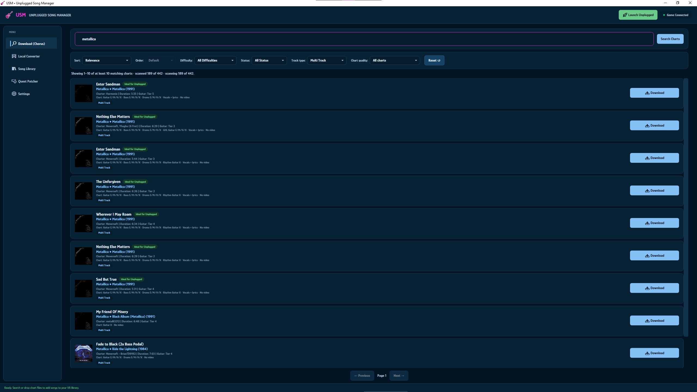
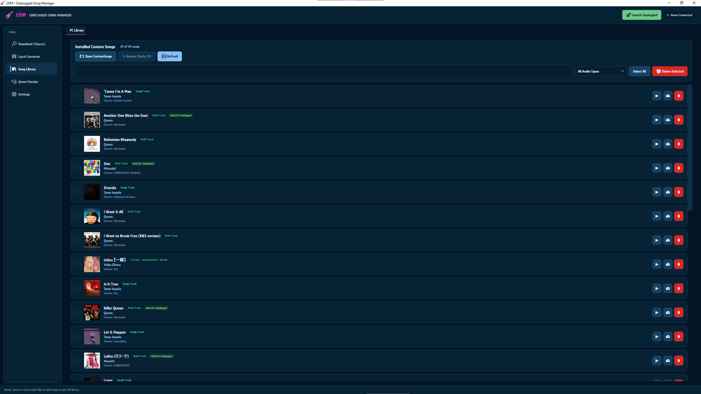
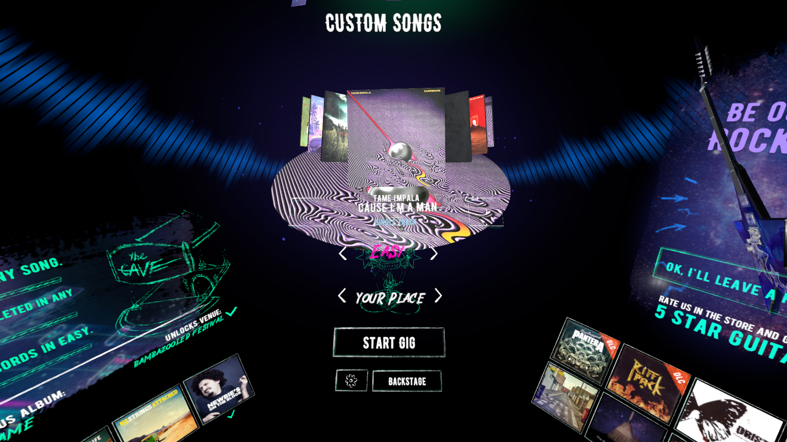
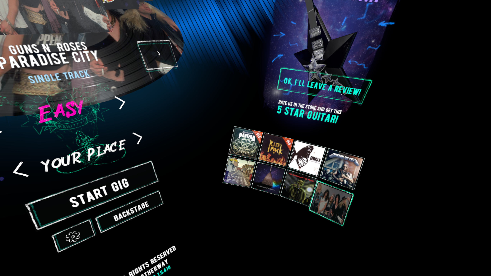

# 🎸 Unplugged Song Manager

Custom songs for **Unplugged: Air Guitar** on Windows PC and Meta Quest. Find charts on [Chorus Encore](https://www.enchor.us/), convert them to `.usm`, manage your library, and install the PC or Quest mod from one Windows app.

**Search charts · Convert songs · Play with hands or controllers · Sync to Quest · 16 interface languages**

[Download the latest release](https://github.com/TheLucXas/UnpluggedSongManager/releases) · [Report a bug](https://github.com/TheLucXas/UnpluggedSongManager/issues)

---

> [!IMPORTANT]
> This is an unofficial community project developed with generative AI. It may contain bugs and is not affiliated with Anotherway, Vertigo Games, Meta, Chorus Encore, or the loader projects. You need your own copy of _Unplugged_ and permission to use the charts and audio you import. Neither this repository nor its releases include the game, commercial songs, or Quest APKs.

## ✨ What it does

| | Feature | What you can do |
| :---: | --- | --- |
| 🔎 | **Find charts** | Search Chorus Encore, sort and filter results, and spot charts marked **Ideal for Unplugged**. |
| 🎼 | **Convert songs** | Download `.sng` charts or import local `.sng`, `.zip`, and Clone Hero / Rock Band song folders containing `notes.mid` or `notes.chart`. |
| 🎚️ | **Keep audio stems** | Identify **Single Track**, **Half Track**, and **Multi Track** packages from their actual audio files, then create compact `.usm` archives with OGG audio, cover art, previews, and charts. |
| ✋ | **Play your way** | Use hand tracking or controllers. USM prepares the appropriate difficulty charts during conversion; the mod adds a Custom Songs album with covers and previews. |
| 📚 | **Manage your library** | Search, preview, select, and remove songs. Resync chart data after parser changes without needlessly converting the audio again. |
| 🥽 | **Play on Quest** | Patch a separate **Unplugged Modded** app, transfer changed songs over USB or Wi-Fi ADB, and manage songs already on the headset. |
| 🛠️ | **Manage mods** | Install, update, reinstall, or remove the PC and Quest mods. USM can install MelonLoader on PC and update the Quest mod without rebuilding its APK. |
| 🔄 | **Stay current** | Check GitHub Releases for USM and mod updates. The interface supports 16 languages. |

**Ideal for Unplugged** is a compatibility hint based on guitar chart coverage, difficulties, notes, and available stems. It cannot guarantee that a community chart was authored perfectly. Instrument labels alone do not prove that a package has separate audio stems.

### Take a look

| Find and convert charts | Browse your library |
| :---: | :---: |
|  |  |
| **Chorus search** | **Song Library** |

| Custom Songs album | Song details in game |
| :---: | :---: |
|  |  |
| **Custom Songs in Unplugged** | **Difficulty and track information** |

## 📋 Requirements

| | What you need |
| --- | --- |
| **USM** | 64-bit Windows and the [.NET 8 Desktop Runtime (x64)](https://dotnet.microsoft.com/en-us/download/dotnet/8.0). Internet access is needed for Chorus search, update checks, and the first FFmpeg download when converting audio. |
| **PC gameplay** | Your own [Unplugged on Steam](https://store.steampowered.com/app/1623390/Unplugged/), a VR setup supported by the game, and [MelonLoader 0.5.7](https://github.com/LavaGang/MelonLoader/releases/tag/v0.5.7). USM can install MelonLoader for you. |
| **Quest gameplay** | Your own original _Unplugged_ installed on the headset, [Quest developer mode](https://developers.meta.com/vr/documentation/android-apps/enable-developer-mode/), an authorized USB or Wi-Fi ADB connection, [Android SDK Platform Tools](https://developer.android.com/tools/releases/platform-tools), and a [Java JDK](https://adoptium.net/temurin/releases/?version=17) on the Windows PC used for patching. USM obtains the other patching tools when needed. |

## 🚀 Install

Download USM and the separate PC / Quest mod DLLs from [Releases](https://github.com/TheLucXas/UnpluggedSongManager/releases). The Windows app still needs the .NET Desktop Runtime above.

### Windows PC

1. Install your own copy of _Unplugged_ and open USM.
2. In **Settings**, select the game folder if USM did not find it.
3. Install **MelonLoader**, then install the **PC mod** from USM.
4. Add songs through **Download (Chorus)** or **Local Converter**.
5. Start the game and choose **Custom Songs**.

### Meta Quest

1. Install your own original _Unplugged_ game, enable developer mode, and connect the headset through ADB.
2. Open **Quest Patcher** in USM and patch the separate **Unplugged Modded** app. The first patch needs Quest tools and Java.
3. Sync your `.usm` songs from **Song Library** or **Quest Patcher**.
4. Launch **Unplugged Modded**. Later mod updates can replace just the Quest mod DLL.

> [!NOTE]
> Keep the signing key in USM's local Quest signing folder. A different APK signature can prevent an in-place update of the cloned app. Your original game, the cloned app, and its song files are separate.

## 🎮 In-game controls and audio

- Select difficulty and browse song covers and previews in the Custom Songs album.
- Skip a long silent introduction shortly before the first note with **A + X** on controllers or the in-game button with hands.
- Move through songs with controller sticks or the hand-tracked carousel gesture and side buttons.
- The PC mod can optionally show Discord Rich Presence and detailed diagnostics.

| Audio label | Package contents |
| --- | --- |
| **Single Track** | One mixed audio track. |
| **Half Track** | Backing / instrumental audio plus vocals. |
| **Multi Track** | Multiple separate stems. |

The mod uses the stems available in each package for its in-game audio behavior.

## 🔄 Updates and removal

USM checks GitHub Releases for updates to the app and both mods. In **Settings**, you can install, update, reinstall, or remove the PC mod and MelonLoader. In **Quest Patcher**, you can update or reinstall the Quest mod without rebuilding the cloned APK or sending every song again. Songs on Quest can be managed from the connected headset's library tab.

## 🧰 Manual installation

USM is optional for installing the loaders and mod DLLs.

| Platform | Steps |
| --- | --- |
| **PC** | Install compatible [MelonLoader](https://github.com/LavaGang/MelonLoader) in the game folder. Put the PC build at `<Unplugged>/Mods/UnpluggedCustomSongs.dll` and `.usm` songs under `<Unplugged>/CustomSongs/`. This project builds against MelonLoader 0.5.7. |
| **Quest** | Patch a separate `com.Anotherway.UnpluggedVR.modded` app with a compatible [LemonLoader installer](https://github.com/LemonLoader/MelonLoaderInstaller). Put `UnpluggedCustomSongs.Quest.dll` in the **Mods directory reported by LemonLoader** (commonly `/sdcard/MelonLoader/com.Anotherway.UnpluggedVR.modded/Mods/`). Put `.usm` songs in `/sdcard/ModData/com.Anotherway.UnpluggedVR.modded/Songs/` and keep the same APK signing key for updates. |

Manual Quest setup also needs a legally obtained APK and matching game data, ADB, Java, and patching / signing tools. Do not put `.usm` songs in `/sdcard/Unplugged/Songs`.

## 🧠 How it works

USM converts compatible Guitar Hero / Rock Band charts and audio into a `.usm` archive. The archive contains the song metadata, cover, preview, OGG audio, and difficulty charts for both input modes. The PC mod loads it through MelonLoader; the Quest mod loads it inside a separate LemonLoader-patched app. Chart resync refreshes chart data while keeping previously converted audio when possible. FFmpeg is downloaded when needed rather than bundled into `USM.exe`.

## 🏗️ Build from source

You need Windows, PowerShell, the [.NET 8 SDK](https://dotnet.microsoft.com/en-us/download/dotnet/8.0), a local PC copy of _Unplugged_ with MelonLoader 0.5.7 for PC references, and Quest IL2CPP interop plus matching Quest MelonLoader assemblies for the Quest build. Those proprietary or generated references are **not** in Git.

Place Quest references in `tools/quest/Il2CppAssemblies/` and `tools/quest/MelonNet/net8/`, or supply a different parent directory with `-QuestReferencesDir`. From the repository root:

```powershell
./tools/Build-USM.ps1 -GameDir 'D:\Games\Unplugged'
```

If references are stored elsewhere:

```powershell
./tools/Build-USM.ps1 -GameDir 'D:\Games\Unplugged' -QuestReferencesDir 'D:\QuestBuildReferences'
```

`-GameDir` is optional when `UNPLUGGED_GAME_DIR` is set, USM has saved the game's location, or the script finds a standard Steam library. The script builds both mod variants and publishes `dist/USM-CSharp/USM.exe`, embedding both mods for installation through USM and producing separate `UnpluggedCustomSongs.PC.dll` and `UnpluggedCustomSongs.Quest.dll` files.

Runtime Quest patching also needs Java, ADB, Apktool, uber-apk-signer, and LemonLoader patching assets. The two JAR tools are under `tools/quest/`; USM can obtain a compatible Quest tool bundle into its local cache. FFmpeg is acquired separately on first use.

```text
src/USM/                    Windows app, converter, library, Quest patcher
mod/UnpluggedCustomSongs/  PC and Quest mod source
tools/Build-USM.ps1         Local build entry point
tools/quest/               Quest tools and local build references
tests/                     Optional development checks
```

Keep local game files, Quest references, saves, captures, APKs, credentials, and device logs outside Git.

## 🩺 Troubleshooting

- **No Custom Songs album on PC:** Check that MelonLoader and the PC mod are installed for the game folder selected in USM.
- **Quest not detected:** Check developer mode, the headset's USB debugging prompt, your data-capable cable, or the Wi-Fi ADB connection in Quest Patcher.
- **A chart needs resync:** Use **Resync Charts** in Song Library. USM keeps the converted audio when it can.
- **Something else broke:** Open a [GitHub issue](https://github.com/TheLucXas/UnpluggedSongManager/issues) with the platform, steps to reproduce, and the relevant USM or loader log. Remove personal information before sharing logs.

## 🗺️ Roadmap

- Search custom songs directly in the in-game album.
- Create and edit charts specifically for _Unplugged_, including hand and controller difficulties.
- Edit song titles, artists, covers, and other `.usm` metadata without reconverting audio.
- Create playlists and mark favorite songs in the library and game.
- Compare PC and Quest libraries and sync only missing or changed songs.
- Add a practice mode with selectable song sections and playback speed.

## 🙏 Credits

- [Unplugged: Air Guitar](https://www.vertigo-games.com/games/unplugged-vr/) by Anotherway / Vertigo Games is the original game. Its assets are not included here.
- [Chorus Encore](https://www.enchor.us/) and its individual chart authors provide community chart discovery and content. A listing does not grant permission to redistribute its audio.
- [Clone Hero](https://clonehero.net/) is part of the chart ecosystem and supported file formats.
- [MelonLoader](https://github.com/LavaGang/MelonLoader), [LemonLoader installer](https://github.com/LemonLoader/MelonLoaderInstaller), [HarmonyX](https://github.com/BepInEx/HarmonyX), and [Il2CppInterop](https://github.com/BepInEx/Il2CppInterop) provide the loader and patching ecosystem. Their separate licenses apply; the LemonLoader installer includes GPL-licensed components.
- [Apktool](https://github.com/iBotPeaches/Apktool), [uber-apk-signer](https://github.com/patrickfav/uber-apk-signer), and [Android Platform Tools](https://developer.android.com/tools/releases/platform-tools) support Quest APK processing, signing, and ADB. The bundled JARs retain their own Apache-2.0 licenses.
- [FFmpeg](https://ffmpeg.org/) and [Gyan's Windows builds](https://www.gyan.dev/ffmpeg/builds/) support audio conversion. FFmpeg's applicable license depends on the build configuration.
- [SimpleJSON](https://github.com/Bunny83/SimpleJSON) by Markus Göbel is used in the mod under MIT; its notice remains in the source.
- [Glory font](https://fonts.google.com/specimen/Glory) is used under the SIL Open Font License 1.1; `OFL.txt` accompanies the font files.
- [PyQt-Fluent-Widgets](https://github.com/zhiyiYo/PyQt-Fluent-Widgets) by zhiyiYo inspired the visual design. USM's active interface uses WPF and does not bundle that library.

See [third-party notices](THIRD_PARTY_NOTICES.md) for redistribution details. Product names and trademarks belong to their respective owners.

## 📄 License

USM's original source code is released under [The Unlicense](LICENSE): use, modify, distribute, or sell it without attributing USM. Third-party code, fonts, tools, the game, and user-provided music and charts keep their own licenses and terms.
